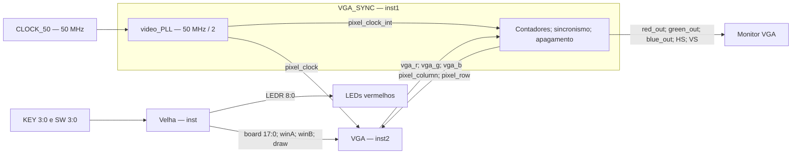
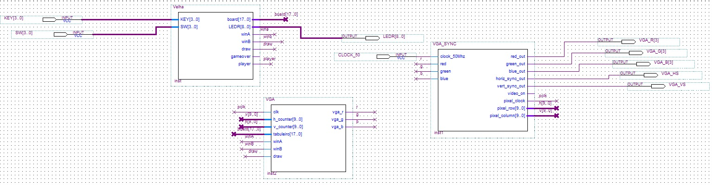

# 02 — Arquitetura e fluxo de sinais

## Estrutura real do circuito

O topo é o esquemático [Block2.bdf](../projeto/Block2.bdf), que instancia `Velha` como `inst`, `VGA_SYNC` como `inst1` e `VGA` como `inst2`. O PLL é instanciado internamente pelo sincronizador. As setas abaixo representam conexões presentes nesse esquemático e nas interfaces HDL.

`Velha → VGA → VGA_SYNC → monitor` descreve o caminho de apresentação dos dados. Há também um caminho no sentido oposto entre sincronização e desenho: **VGA_SYNC fornece o clock e as coordenadas a VGA**. A realimentação representa a varredura da imagem, sem alterar o tabuleiro.

## Esquemático original

*Figura 1 — Integração original no Quartus. Rótulos de rede conectam sinais mesmo quando não há um fio contínuo entre os blocos.* A fonte editável é [Block2.bdf](../projeto/Block2.bdf); a imagem permite consultar o circuito diretamente no GitHub.

## Controle e apresentação

O módulo [Velha](../projeto/Velha.v) recebe as chaves e os botões, conserva `board[17:0]` e produz `winA`, `winB` e `draw`. O módulo [VGA](../projeto/VGA.v) recebe esses dados e identifica a cor correspondente às coordenadas de cada pixel. A tela acompanha o estado armazenado, independentemente de haver uma nova jogada.

`player` alterna o participante dentro de `Velha`. Sua saída aparece no símbolo e possui rótulo no esquemático, mas não alimenta `VGA`. Assim, as legendas laterais mostram as cores e os resultados, sem um indicador gráfico de turno nessa implementação. `gameover` bloqueia jogadas dentro do controlador e aciona `LEDR[8]`; seu terminal não possui conexão externa no BDF.

## Mapeamento das redes

| Origem | Rede no BDF | Destino | Significado |
|---|---|---|---|
| `Velha.board[17:0]` | `board[17..0]` | `VGA.tabuleiro[17:0]` | Nove pares de bits |
| `Velha.winA` | `wina` / `winA` | `VGA.winA` | Vitória azul |
| `Velha.winB` | `winb` / `winB` | `VGA.winB` | Vitória vermelha |
| `Velha.draw` | `draw` | `VGA.draw` | Empate |
| `VGA_SYNC.pixel_clock` | `pclk` | `VGA.clk` | Relógio de pixels |
| `VGA_SYNC.pixel_column[9:0]` | `v[9..0]` | `VGA.h_counter[9:0]` | Coordenada horizontal |
| `VGA_SYNC.pixel_row[9:0]` | `h[9..0]` | `VGA.v_counter[9:0]` | Coordenada vertical |
| `VGA.vga_r/g/b` | `r`, `g`, `b` | `VGA_SYNC.red/green/blue` | Cor antes do apagamento |

Os rótulos intermediários `h` e `v` devem ser lidos com atenção: **`v` transporta a coluna e `h` transporta a linha**. A conexão final chega à porta semanticamente correta de `VGA`. Ao reproduzir o esquema, seguir a tabela de origem e destino, sem inferir a função apenas pela letra do rótulo.

As grafias `wina` e `winA`, assim como `winb` e `winB`, aparecem nas redes nomeadas do BDF. O esquemático e os símbolos originais são preservados; a interpretação deve ser feita pelo ambiente Quartus, mantendo as ligações existentes.

## Saídas físicas

`red_out`, `green_out` e `blue_out` de `VGA_SYNC` chegam, respectivamente, a `VGA_R[3]`, `VGA_G[3]` e `VGA_B[3]`. Cada cor possui um único sinal lógico nesta implementação. Os bits 0 a 2 dos canais não são portas de saída do topo, apesar de constarem no modelo geral de pinos.

`horiz_sync_out` chega a `VGA_HS`; `vert_sync_out`, a `VGA_VS`. O sinal `video_on` é utilizado internamente para o apagamento RGB e seu terminal de saída não está conectado a outro bloco no topo.

O barramento `LEDR[8:0]` sai diretamente de `Velha`. A indicação de vitória azul usa LEDs fisicamente vermelhos: a cor do participante corresponde à representação VGA, e não à cor física desse banco de LEDs.

## Domínios de eventos

A partida é atualizada a partir de KEY2; a imagem é atualizada pelo relógio de pixels. O esquema transfere o vetor do tabuleiro e os indicadores diretamente entre esses domínios, sem protocolo de transferência ou sincronizadores explícitos. As simulações funcionais dos módulos verificam a lógica com entradas estáveis; não certificam a temporização dessa travessia. Essa distinção é relevante ao interpretar os [resultados de validação](09-validacao.md).

---

[Capítulo anterior](01-introducao.md) · [Índice](../README.md#roteiro-de-estudo) · [Próximo capítulo](03-logica-do-jogo.md)
