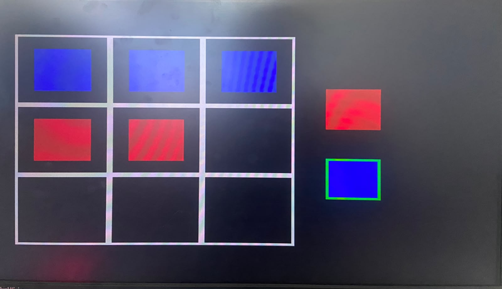
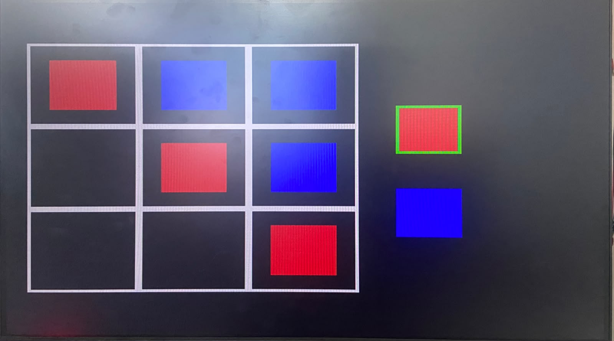
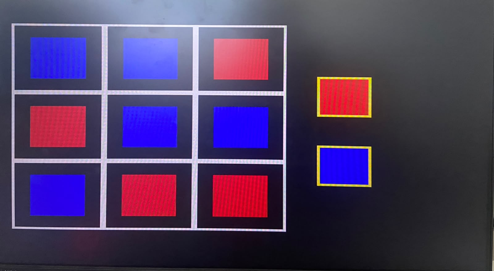
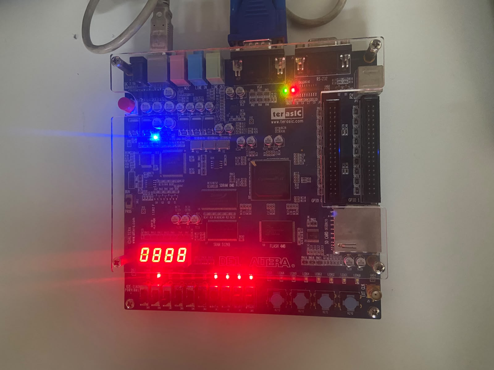

# 08 — Utilização, exemplos e resultados

## Convenção de leitura

```text
 1 | 2 | 3
---+---+---
 4 | 5 | 6
---+---+---
 7 | 8 | 9
```

Cada número corresponde ao valor binário configurado em `SW[3:0]`. Cada item de uma sequência abaixo significa selecionar a casa e pressionar KEY2. Pressionar KEY0 antes de iniciar uma nova sequência. `A` indica azul; `V`, vermelho; `.` indica casa vazia. O azul realiza a primeira jogada.

As sequências são **exemplos didáticos reproduzíveis**, com resultado coerente com o HDL publicado. As fotografias são registros originais do experimento; não registram a ordem em que as jogadas foram feitas. As simulações realmente executadas são descritas separadamente em [Validação](09-validacao.md).

## Vitória horizontal azul

| Jogada | Participante | Casa | Resultado após confirmar |
|---|---|---|---|
| 1 | Azul | 1 | Primeira marca azul |
| 2 | Vermelho | 4 | Primeira marca vermelha |
| 3 | Azul | 2 | Duas marcas azuis na primeira linha |
| 4 | Vermelho | 5 | Duas marcas vermelhas na segunda linha |
| 5 | Azul | 3 | Vitória azul: casas 1, 2 e 3 |

```text
 A | A | A
---+---+---
 V | V | .
---+---+---
 . | . | .
```

`board[0]`, `board[2]` e `board[4]` passam a 1. O controlador registra `winA = 1`, `winB = 0`, `draw = 0` e `gameover = 1`. Acendem `LEDR[3:0]` e `LEDR[8]`; a legenda azul recebe borda verde. O vetor final é `board = 18'h00295`.



*Figura 2 — Primeira linha azul e borda verde na legenda inferior. A configuração visível coincide com o tabuleiro do exemplo; a fotografia não determina sua sequência de entrada.*

## Vitória diagonal vermelha

Uma sequência possível é **2, 1, 3, 5, 6, 9**, alternando azul e vermelho:

```text
 V | A | A
---+---+---
 . | V | A
---+---+---
 . | . | V
```

O vermelho ocupa 1, 5 e 9: os bits 1, 9 e 17 ficam em 1. `winB = 1`, `gameover = 1`, `winA = 0` e `draw = 0`. Acendem `LEDR[7:4]` e `LEDR[8]`; a borda da legenda vermelha torna-se verde. O vetor final é `board = 18'h20616`.



*Figura 3 — Diagonal principal vermelha, com borda verde na legenda superior.*

Também é possível estudar a diagonal secundária: **3, 1, 5, 2, 7** produz vitória azul nas casas 3, 5 e 7. Os bits azuis correspondentes são 4, 8 e 12. Esse exemplo não possui fotografia específica no conjunto.

## Empate

A sequência **1, 3, 2, 4, 5, 8, 6, 9, 7** preenche o tabuleiro sem formar linha de três marcas iguais:

```text
 A | A | V
---+---+---
 V | A | A
---+---+---
 A | V | V
```

Depois da nona confirmação, os nove pares estão ocupados. Como nenhuma vitória foi detectada antes, `draw = 1`, `gameover = 1` e `winA = winB = 0`. Apenas `LEDR[8]` acende; as duas legendas recebem bordas amarelas. O vetor final é `board = 18'h295A5`.



*Figura 4 — Tabuleiro completo e duas bordas amarelas, indicando o empate.*

## Casa ocupada e valores inválidos

Após reset, selecionar a casa 5 e pressionar KEY2 registra azul no centro e passa o turno ao vermelho. Selecionar novamente 5 e pressionar KEY2 não altera o tabuleiro: um dos dois bits da casa já está ocupado. `player` continua em 1, permitindo ao vermelho escolher outra casa.

Selecionar zero ou um valor entre 10 e 15 também não altera o estado. A validação de intervalo acontece antes do cálculo dos índices. Não existe uma mensagem gráfica de erro; a rejeição é percebida pela conservação da casa e do turno. Alterar apenas as chaves, sem pressionar KEY2, também não registra uma jogada.

## Encerramento e reinício

Depois de uma vitória, até mesmo selecionar uma casa vazia e pressionar KEY2 conserva o resultado, pois `gameover = 1`. Para reiniciar, pressionar KEY0. A ação assíncrona zera `board`, `winA`, `winB`, `draw` e `gameover`, e faz `player = 0`.

Na tela, desaparecem as marcas e as bordas de resultado; a grade e as duas legendas permanecem. Os LEDs do jogo se apagam, e o próximo turno pertence ao azul. O reset atua sobre a partida; não reinicializa os contadores de vídeo do sincronizador.

## Montagem física e alcance das evidências



*Figura 5 — Placa DE1, com conexões VGA e USB e os controles de entrada visíveis.* A fotografia documenta a montagem, sem permitir atribuir a função dos displays de sete segmentos ao circuito: esses displays não são saídas do topo `Block2`.

As fotografias comprovam a aparência registrada no experimento, mas não identificam o hash do arquivo de configuração gravado. A publicação foi verificada por simulação funcional e inspeção de arquivos; não foi realizada uma nova medição de sinais VGA ou execução física com o conteúdo publicado.

---

[Capítulo anterior](07-compilacao-e-gravacao.md) · [Índice](../README.md#roteiro-de-estudo) · [Próximo capítulo](09-validacao.md)
